<!-- © 2026 Roy Borkin. All rights reserved. -->
# Argaz – parametric crate

A browser configurator for stackable plastic crates, based on the Tnuva crate Grasshopper definition.
Everything runs client-side: [Manifold](https://github.com/elalish/manifold) (WASM) builds a watertight solid in a Web Worker, and [three.js](https://threejs.org) renders it.


## From the real crate to the model

The reference is the Tnuva dairy crate: square, rounded corners, horizontal ribs, rows of vertical slots, hand holds under the rim, and a foot that locks into the crate below.

| The original Tnuva crate | Generated in Argaz |
| --- | --- |
|  |  |
|  | 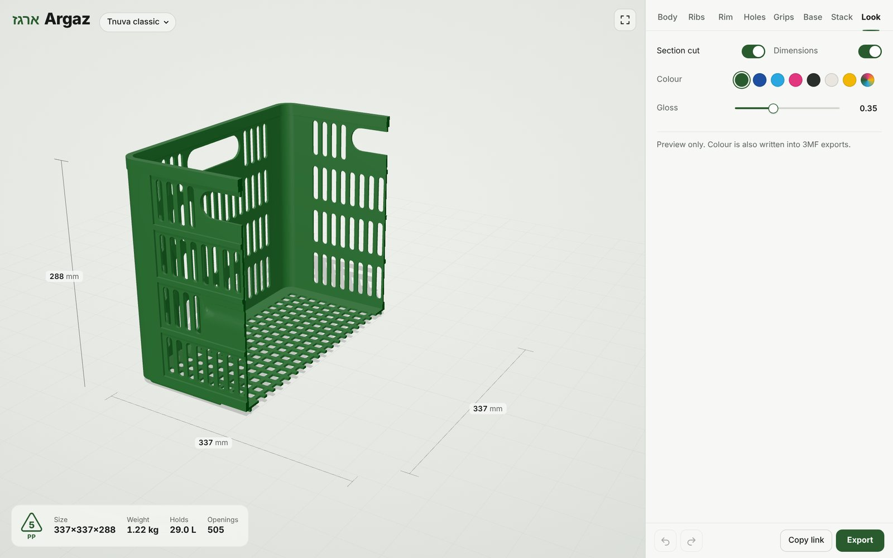 |
|  |  |


The crate comes in several colours; the colour picker sets the preview, the accent of the interface and the colour written into 3MF files.

## Screenshots

| Presets | Hex bin with hex openings |
| --- | --- |
|  |  |

On phones the controls move into a bottom sheet; every tab fits on one screen without scrolling.

<p>
  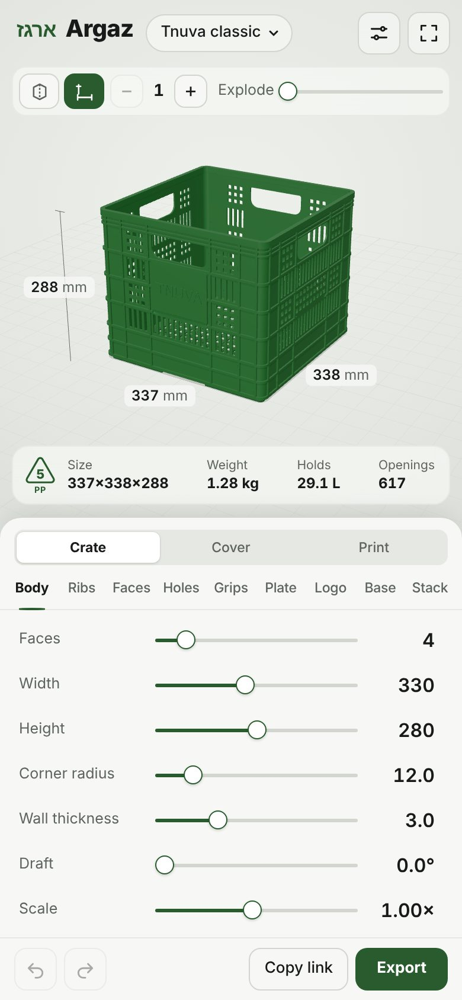
  &nbsp;
  
</p>

## Matching the real crate

The **Tnuva classic** preset (the default) was rebuilt against a photo of the real crate. The first version is kept as **Tnuva basic**.

| Detail on the real crate | Parameter |
| --- | --- |
| Thin lines clustered under the top rim | Stack › Top rim, Lines under rim |
| Bands of different heights; solid bands at the bottom; small squares in some bands | Ribs › Band layout, e.g. `48q 48 48q 48 28s 28s` (top to bottom, q = squares, s = solid) |
| Solid corner columns framed by vertical ribs, horizontal ribs running across them | Faces › Corner column, Corner ribs (Stack › Corner pillars off) |
| Vertical ribs splitting each face into three columns | Faces › Columns, Centre column, Vertical rib |
| Hand hold with a flat top under the rim and a round bottom | Grips › Shape: Tub, Top radius, Bottom radius |
| Smooth panel spanning two bands, raised over the ribs | Plate › In band, Bands tall, Raise |
| Name moulded into the panel | Logo › Text or Image, Raised / Engraved / Cut through |

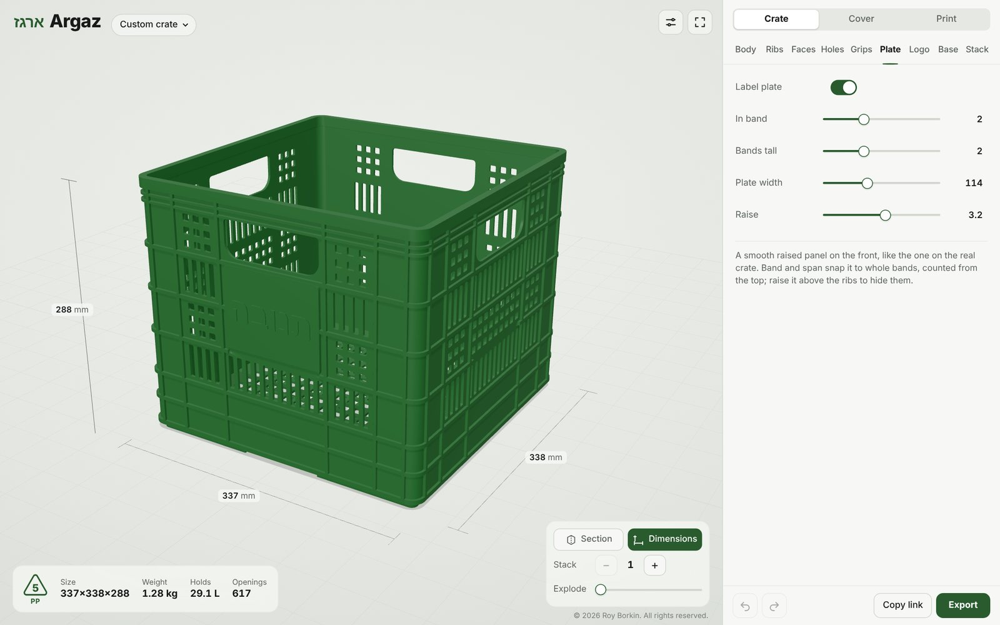

### Logo

Type a name (any language the browser can render, Hebrew included) or upload a PNG, JPG, SVG or WebP. Dark or opaque pixels become the logo. It can be raised, engraved or cut through, on the front, on opposite faces or on all faces, and on top of the cover. Depth is in real millimetres. Uploaded images stay in your browser and are not part of shared links.

### View options

The view box on the 3D stage holds the section cut, dimensions, stack preview (− / +) and the exploded view. The sliders button at the top right holds colour and gloss; **Mixed colours** gives every crate in the stack its own colour, and **Shuffle** deals a new set.

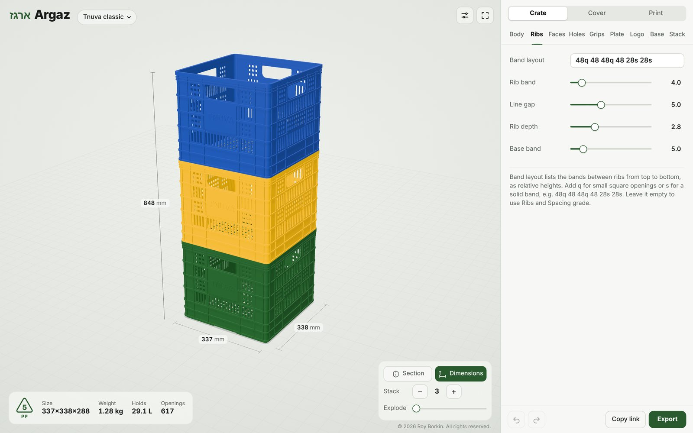

## Cover maker

The **Cover** tab builds a lid for the crate: plate thickness, overhang, grip notches or a hand slot, and fit clearance.

- **Stacks both ways.** A skirt underneath locks the cover onto the crate below; a lip on top takes the foot of a crate stacked on the cover.
- **Underside ribs** in a grid or radial pattern stiffen it enough to sit on.
- **Vents** in grid, slot, hex or round patterns stay clear of the skirt and lip.
- **Seat.** Strap slots, tie holes or a raised frame hold a cushion, so the crate becomes a stool.
- **Cushion frame:** a printable tray the foam sits in, exported with the print set.
- **Foam template:** Export › Foam template, SVG gives the cushion outline at 1:1 with the strap or tie positions marked and a 100 mm check line. Print it at 100 % and cut the foam around it.

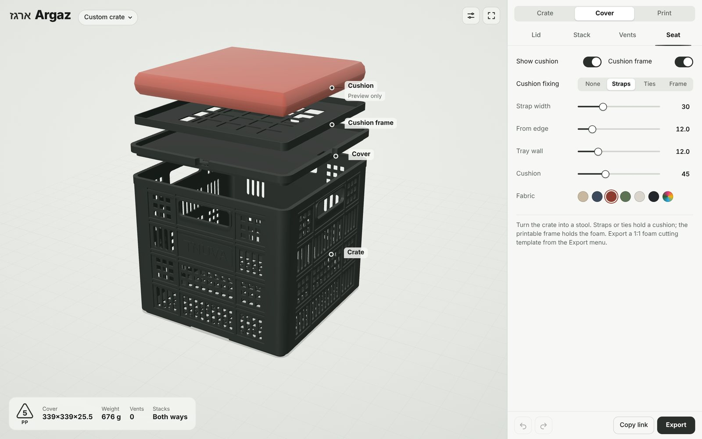

| Crate stool with a cushion | Stacking cover with hex vents |
| --- | --- |
| 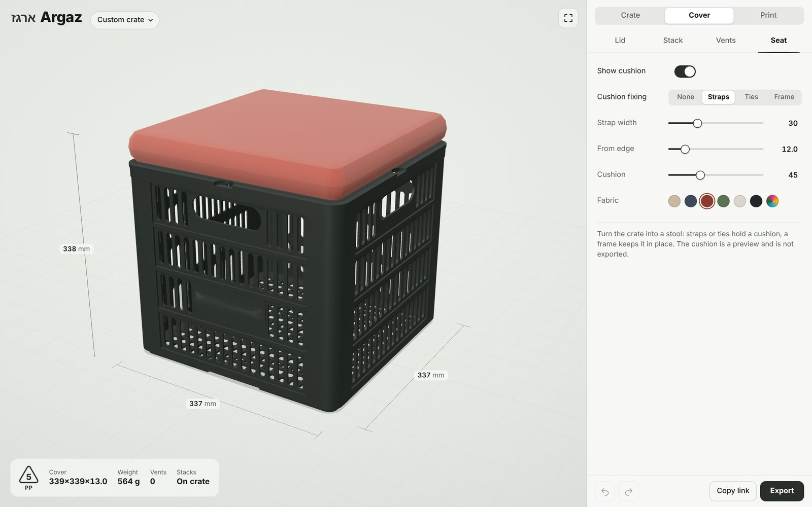 | 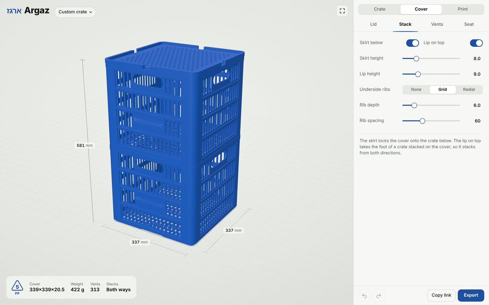 |

## Print-ready export

The **Print** tab prepares the crate for a 3D printer:

- **Print-ready** adds 45° chamfers under every rib and rim so every part prints upright with no supports.
- **Foot:** *Original* keeps the real crate's foot and makes it printable by printing it as a separate ring that plugs into a groove under the floor (the floor then prints flat on the bed). *45° shoulder* makes it one piece, with the floor moved to the bottom of the foot and a sloped shoulder above it.
- **Separate base** splits the floor and stacking foot from the walls; **Wall sections** splits the walls at ribs (where there are no openings) so tall crates fit your printer.
- **Joints:** *Snap* (catches on the tongue with flex slits, recesses in the groove), *Glue* (a glue gap plus two grooves that hold adhesive) or *Tight gap* (a press fit). Gaps, snap bumps and joint depth are real millimetres and do not change with scale.
- A cover with features on both faces is split through the middle of its plate, so both halves print flat; corner pegs line them up.
- **Vertical cut** (halves or quarters) splits every part down the middle so a full-size crate fits a small bed. On a square crate the cut runs along a vertical rib, so it crosses solid plastic. The pieces are joined with pins cut from 1.75 mm filament plus glue; the holes are already in the parts.
- **Bed:** pick a printer or set any bed size up to 1 m, so the same tool works for large-format printers. **Fit to bed** turns on Print-ready and picks wall sections and vertical cuts for that bed. Nothing in the Print tab changes the crate unless Print-ready is on, so the model stays a normal crate for other manufacturing methods.
- **Exploded view** pulls the parts apart with labels; **Bed view** lays them out on the print bed, packed onto as many plates as your printer needs. Oversized or too-tall parts are marked in red.
- Export the whole set as one **3MF** (every part laid out) or as a **zip of STL files**, one per part, already oriented, with assembly notes.

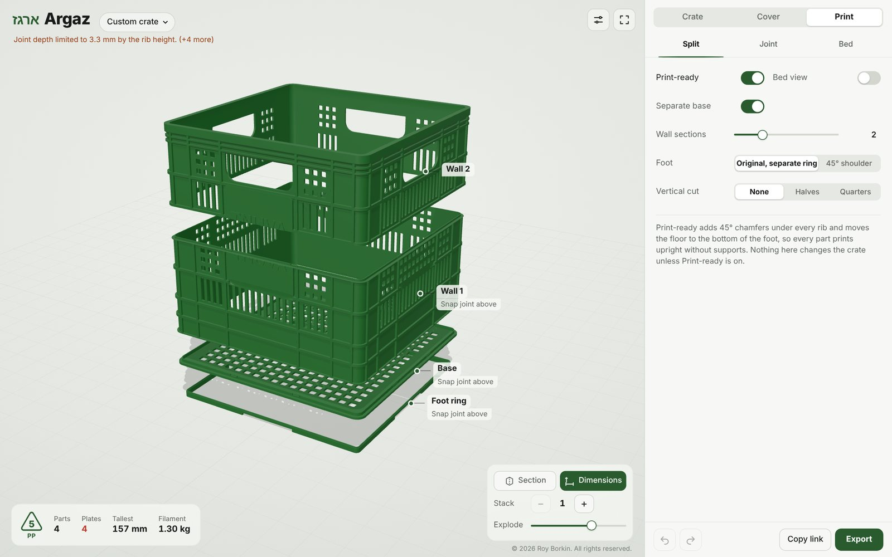

| Exploded view | Bed view, ⅓-scale kit on a 256 mm bed |
| --- | --- |
| 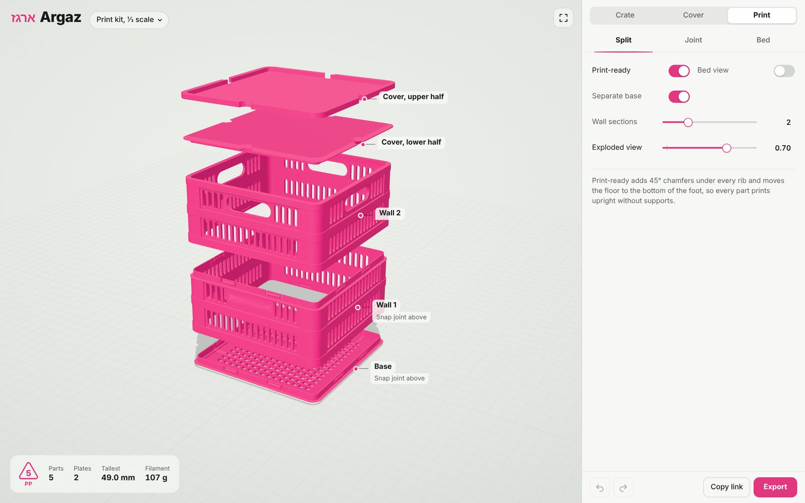 | 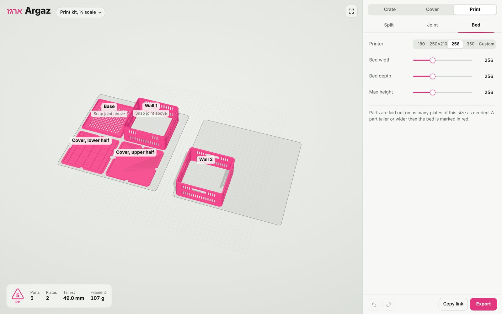 |

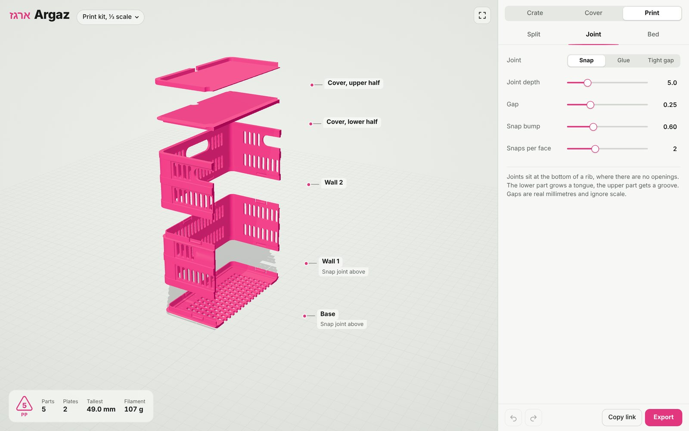

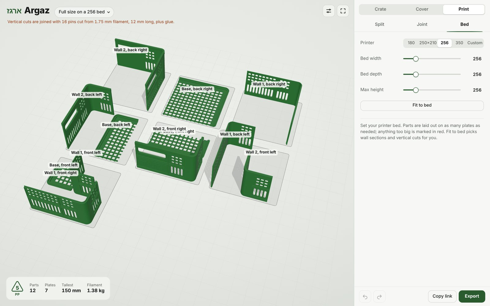

## Scale and thickness

Scale multiplies everything, wall thickness included. When the scale is not 1, the summary panel shows the real wall thickness, and the Body tab lists wall, floor, rib and rim sizes. Walls under 0.8 mm (two lines of a 0.4 mm nozzle) are flagged in red.

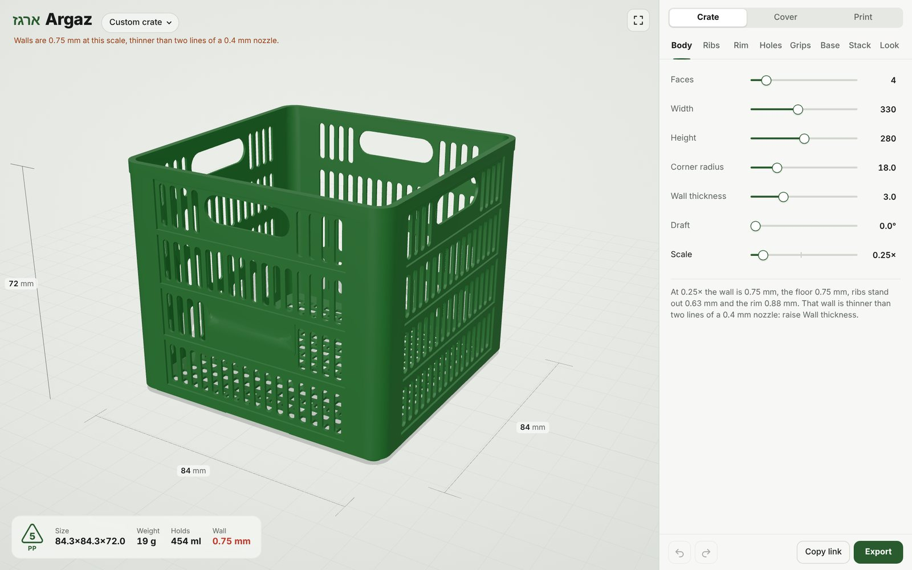

## Deploy to GitHub Pages

1. Create a repository and copy this folder's contents into it (keep the folder structure).
2. Commit and push.
3. In the repository go to **Settings → Pages**, set **Source** to *Deploy from a branch*, choose `main` and `/ (root)`, and save.
4. The site appears at `https://<user>.github.io/<repo>/` after a minute.

There is no build step. All libraries are vendored in `vendor/`, so the app works offline after the first load (the Archivo web font is the only external request, and it falls back to the system font).

To run locally, serve the folder over HTTP (module workers do not load from `file://`):

```
python3 -m http.server 8000
```

## Files

| Path | What it does |
| --- | --- |
| `index.html` | Page shell, import map |
| `css/app.css` | Layout (desktop side panel, phone bottom sheet), controls, motion |
| `js/params.js` | Parameter schema, tabs, presets, URL encoding. Add a parameter here and the UI builds itself |
| `js/crate.js` | The geometry: crate shell, column ribs, twin ribs, alternating bands, hand holds with frames, label plate and logo, floor, foot, draft; print splitting with snap, glue and press joints; vertical cuts with filament pins; cover, cushion frame and cushion |
| `js/geometry.worker.js` | Runs `crate.js` off the main thread, computes creased normals |
| `js/viewer.js` | three.js scene: parts, stack preview, exploded view, animated bed view, part callouts, section cut, dimension lines |
| `js/main.js` | UI generation, undo/redo, presets, sharing, exports |
| `js/exporters.js` | STL (binary), multi-object 3MF, OBJ, ZIP writers |
| `js/logo.js` | Renders logo text or an uploaded image to a canvas and turns it into rectangles for the geometry |
| `docs/` | README images: original crate photos and app screenshots (not loaded by the app) |

## How the model is built (vs. the Grasshopper definition)

The GH file builds one wedge (one side plus one corner), extrudes and offsets it, and rotates it N times; holes were not modelled.
This version builds the whole crate at once:

- the outline is an exact rounded regular polygon, so wall offsets are true offsets at any corner radius;
- each flat face is a 2D panel with its openings cut in 2D and then extruded, which is fast and always watertight;
- openings fill the bands between ribs and keep clear of corner pillars, hand holds and the label plate;
- ribs, rim, pillars and the plate are unioned as solids, and hand holds are cut through them;
- draft (for nesting) is applied as a single warp at the end;
- the stacking foot is sized from the wall and rim so it drops into the crate below with the chosen clearance.

Units are millimetres. Exports are Z-up (STL, 3MF, OBJ); GLB is Y-up in metres as glTF expects.

## Copyright and licence

© 2026 Roy Borkin. All rights reserved. See [LICENSE](LICENSE).

The code, design and documentation may not be copied, modified or redistributed without written permission. Exported files carry the same notice (STL header, 3MF metadata, OBJ and SVG comments).

The libraries in `vendor/` keep their own licences: three.js (MIT) and Manifold (Apache 2.0), with their licence files next to them. "Tnuva" is a trademark of its owner; this project is not affiliated with Tnuva.
