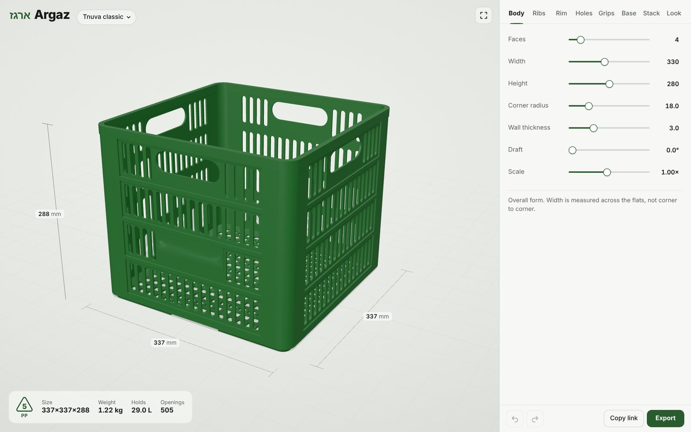
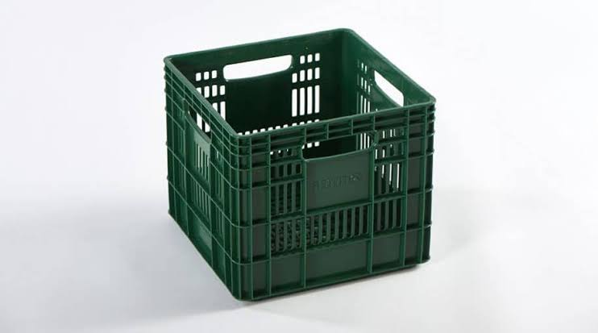
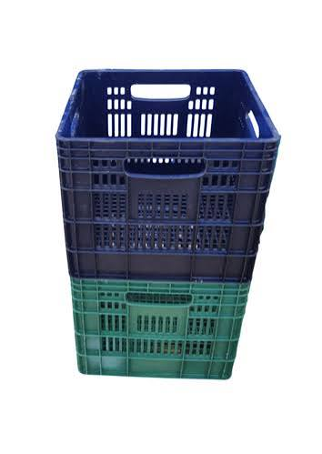
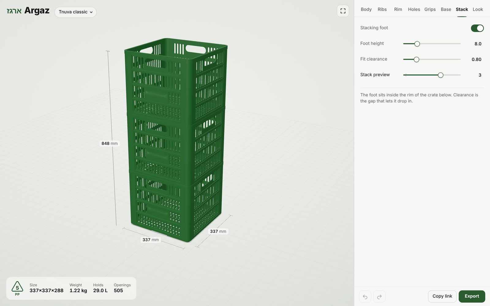
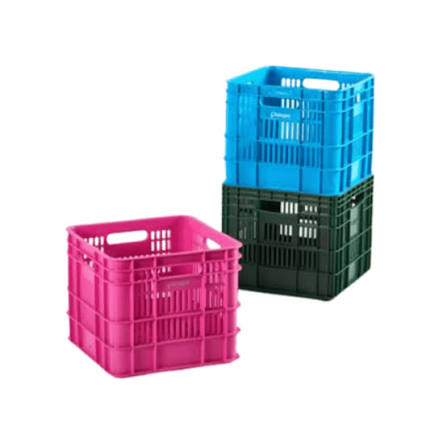
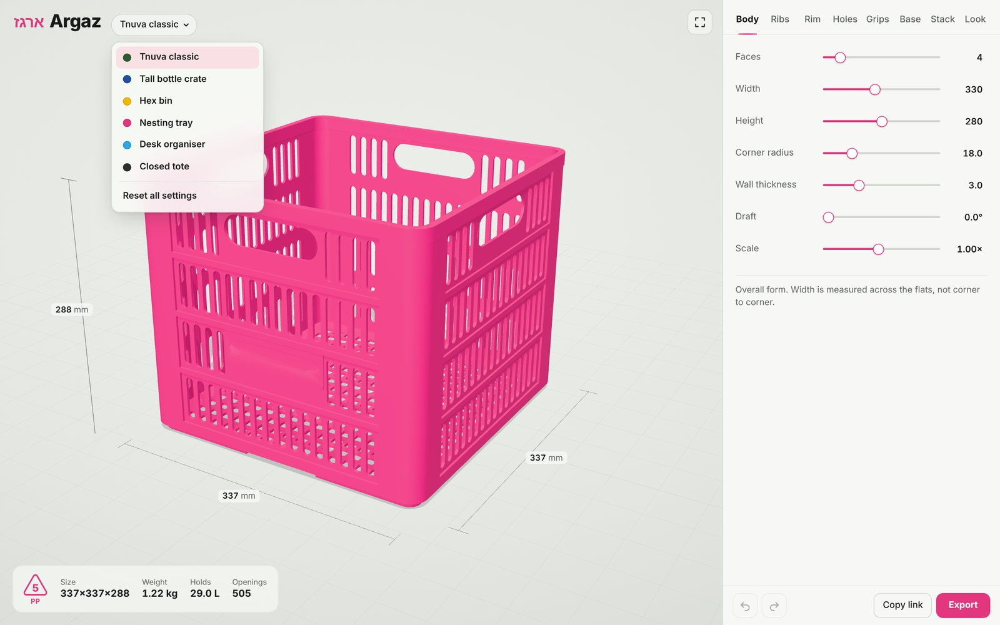
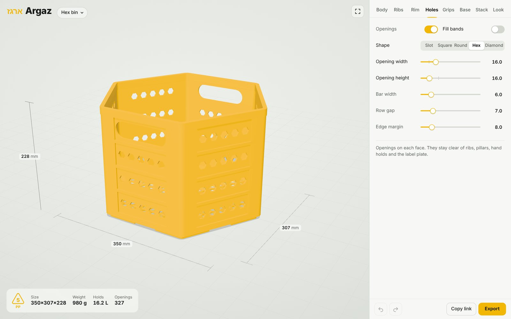
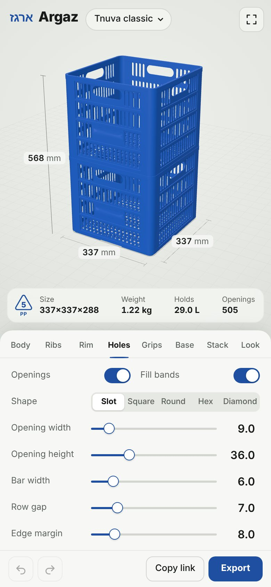

# Argaz – parametric crate

A browser configurator for stackable plastic crates, based on the Tnuva crate Grasshopper definition.
Everything runs client-side: [Manifold](https://github.com/elalish/manifold) (WASM) builds a watertight solid in a Web Worker, and [three.js](https://threejs.org) renders it.



## From the real crate to the model

The reference is the Tnuva dairy crate: square, rounded corners, horizontal ribs, rows of vertical slots, hand holds under the rim, and a foot that locks into the crate below.

| The original Tnuva crate | Generated in Argaz |
| --- | --- |
|  |  |
|  |  |



The crate comes in several colours; the colour picker sets the preview, the accent of the interface and the colour written into 3MF files.

## Screenshots

| Presets | Hex bin with hex openings |
| --- | --- |
|  |  |

On phones the controls move into a bottom sheet; every tab fits on one screen without scrolling.

<p>
  
  &nbsp;
  
</p>

## Deploy to GitHub Pages

1. Create a repository and copy this folder's contents into it (keep the folder structure).
2. Commit and push.
3. In the repository go to **Settings → Pages**, set **Source** to *Deploy from a branch*, choose `main` and `/ (root)`, and save.
4. The site appears at `https://<user>.github.io/<repo>/` after a minute.

There is no build step. All libraries are vendored in `vendor/`, so the app works offline after the first load (the Archivo web font is the only external request, and it falls back to the system font).

To run locally, serve the folder over HTTP (module workers do not load from `file://`):

```
python3 -m http.server 8000
```

## Files

| Path | What it does |
| --- | --- |
| `index.html` | Page shell, import map |
| `css/app.css` | Layout (desktop side panel, phone bottom sheet), controls, motion |
| `js/params.js` | Parameter schema, tabs, presets, URL encoding. Add a parameter here and the UI builds itself |
| `js/crate.js` | The geometry: rounded N-gon shell, 2D-cut face panels, ribs, rim, pillars, hand holds, label plate, floor pattern, stacking foot, draft |
| `js/geometry.worker.js` | Runs `crate.js` off the main thread, computes creased normals |
| `js/viewer.js` | three.js scene, stack preview, section cut, dimension lines |
| `js/main.js` | UI generation, undo/redo, presets, sharing, exports |
| `js/exporters.js` | STL (binary), 3MF, OBJ writers |
| `docs/` | README images: original crate photos and app screenshots (not loaded by the app) |

## How the model is built (vs. the Grasshopper definition)

The GH file builds one wedge (one side plus one corner), extrudes and offsets it, and rotates it N times; holes were not modelled.
This version builds the whole crate at once:

- the outline is an exact rounded regular polygon, so wall offsets are true offsets at any corner radius;
- each flat face is a 2D panel with its openings cut in 2D and then extruded, which is fast and always watertight;
- openings fill the bands between ribs and keep clear of corner pillars, hand holds and the label plate;
- ribs, rim, pillars and the plate are unioned as solids, and hand holds are cut through them;
- draft (for nesting) is applied as a single warp at the end;
- the stacking foot is sized from the wall and rim so it drops into the crate below with the chosen clearance.

Units are millimetres. Exports are Z-up (STL, 3MF, OBJ); GLB is Y-up in metres as glTF expects.

## Licences

three.js and Manifold are MIT/Apache-2.0 licensed; their licence files are in `vendor/`.
